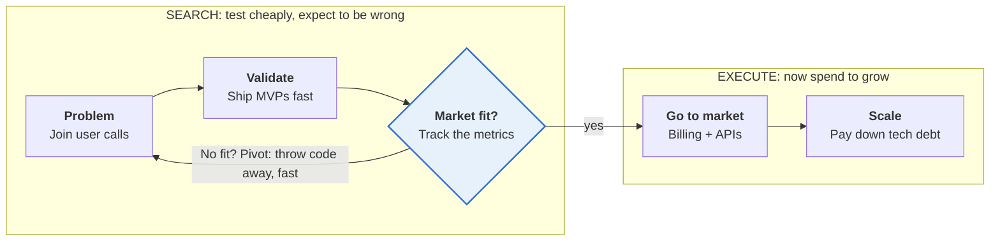
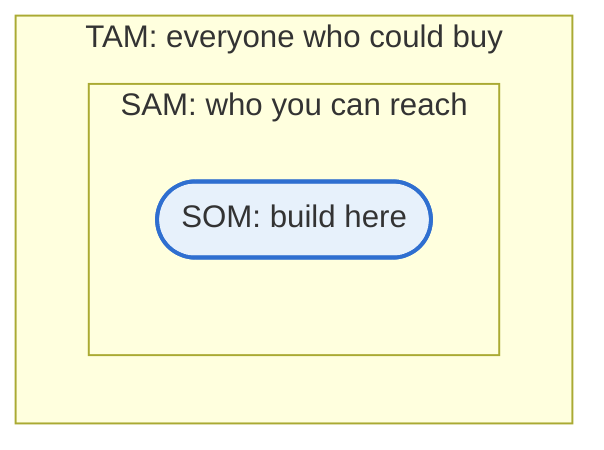
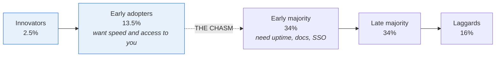
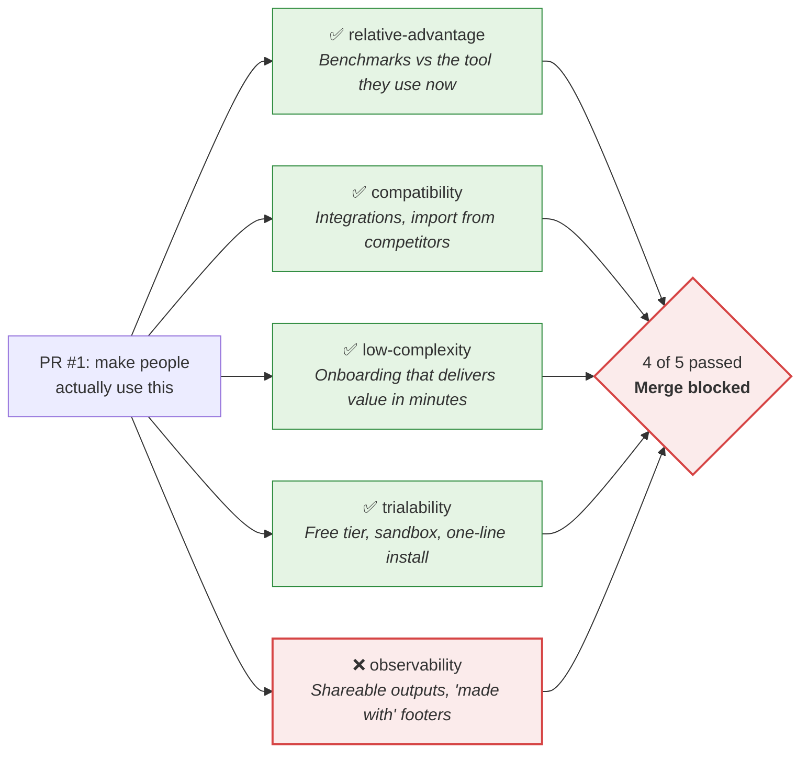
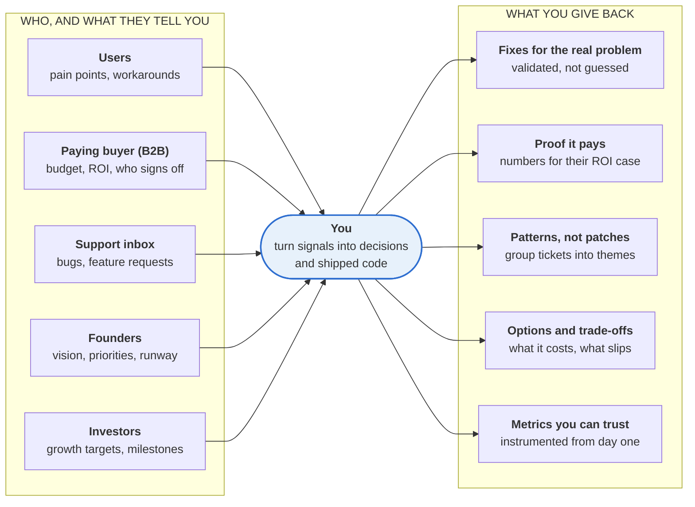
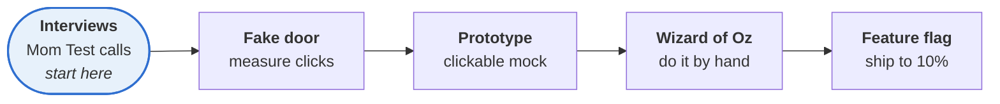

# Commercialisation for Founding Engineers

> ### *Get out of the repo and into the room.*
> The bugs that kill startups aren't in your code. They're in the gap between what you built and what anyone will pay for.

**There's no sales team yet. There's you.** As a founding engineer in a startup, you'll both ship the product *and* help prove anyone wants it. That matters, because your equity is only worth something if the company finds a market. In a study of 101 failed startups, the top killer (42%) wasn't bad code, it was "no market need" ([Fortune](https://fortune.com/2014/09/25/why-startups-fail-according-to-their-founders/)). Without a market, even perfect code is dead code: it might compile and pass every test but nothing will ever call it.

---

## Key concepts: where you fit in

> **Final edit:** a five-box horizontal flow titled *"Your job changes at every stage of the loop"*. Brackets above group the first three boxes as **Search** and the last two as **Execute**. "Market fit?" is highlighted, and an arrow loops back from it to "Problem".

- **You are the experiment engine.** In a trial of 116 startups, teams that tested hypotheses like scientists performed better ([Camuffo et al., 2020](https://pubsonline.informs.org/doi/10.1287/mnsc.2018.3249)). Treat every feature like a pull request against reality: ship it small, log everything and let the data review it.

### Who are you building for, and who's next?

Your backlog is a market decision in disguise. Every sprint, you're choosing *which customers* your code serves. These two models tell you who to build for now, and what engineering it'll take to win the next group.

**1. Who your backlog should serve**

**2. What each group needs from your code** (Rogers' adopter groups, Moore's chasm)

> **Final edit:** one figure, two panels, titled *"Build for who you can win now, then engineer your way across"*. Left: three nested circles (TAM, SAM, SOM), with SOM highlighted and labelled "build here". Right: the adoption bell curve. The innovators and early adopters are shaded, and a red dashed line marks the chasm.

| Idea | What it means for your work |
| --- | --- |
| **Build for the SOM, not the TAM** | Ignore features for the giant market you *might* reach one day. Prioritise what wins the small group you can realistically sign this year. |
| **Early adopters** (left of the chasm) | They want speed and access to you. Rough edges, hacky fixes and a direct line to the engineer are fine. |
| **Early majority** (right of the chasm) | They want a *whole product*: uptime, docs, integrations, security, single sign-on, data export. |
| **Crossing the chasm** | The founders sell the vision; you build the reliability that lets a cautious buyer say yes. |

### Why some products spread and others don't

Sociologist Everett Rogers found five factors that decide how fast a new technology spreads (*Diffusion of Innovations*, 1962). Every one of them is something you build. Think of them as checks that have to pass before your product can "merge" into people's lives:

| Check | Means | What the engineer builds |
| --- | --- | --- |
| ✅ `relative-advantage` | Clearly better than what they use now | Benchmarks vs the tool they use now |
| ✅ `compatibility` | Fits their existing tools and habits | Integrations, import from competitors |
| ✅ `low-complexity` | Simple to understand and start using | Onboarding that delivers value in minutes |
| ✅ `trialability` | Easy to try with little commitment | Free tier, sandbox, one-line install |
| ❌ `observability` | Others can see the benefit | Shareable outputs, "made with" footers |

> **Final edit:** styled as a GitHub pull-request checks panel. Four green ticks and one red cross, with the footer: *"4 of 5 checks passed. Merge blocked: users love it, but nobody else can see it, so word of mouth never starts."*

**Try it:** run the pipeline on your current project or your company's product. Which check would fail today, and what's the smallest thing you could ship this week to turn it green?

---

## Your new job: researcher, interviewer, experimenter

At a small startup, nobody hands you a spec. There's no product manager or research team. You'll find the problem, talk to the customer, build the feature and prove it worked, end to end.

> **Final edit:** titled *"Signals come in, decisions go out"*. Three columns: the five groups on the left, a tall highlighted "You" box in the middle, and what you give back on the right. Each output sits directly across from its group.

### 1. Do your own market research

| Method | What it tells you | Where to start |
| --- | --- | --- |
| Social listening | What users complain about unprompted | Reddit, Discord, app-store reviews, your support inbox |
| Usage data | What people *do*, not what they say | Product analytics, logs, signup funnels |
| Competitor teardown | Gaps, pricing and positioning | Competitors' changelogs and pricing pages, [TechIreland](https://techireland.org/) |
| Desk research | Where the market is heading | Google Trends, Gartner, industry reports through your university library |
| Customer calls | *Why* they behave that way | Aim for a few calls every week |

### 2. Talk to customers without fooling yourself

People are polite, so they'll say your idea is great. Rob Fitzpatrick's book *The Mom Test* gives three rules for questions even your mum can't lie to you about ([summary](https://mtlynch.io/book-reports/the-mom-test/)):

1. Talk about their life, not your idea.
2. Ask about specific things that happened in the past, not opinions about the future.
3. Talk less, listen more.

| Instead of... | Ask... |
| --- | --- |
| "Would you use a feature that does X?" | "When did this last happen? What did you do?" |
| "Do you like our dashboard?" | "What did you try before us, and why did you switch?" |
| "We'll add export, sound good?" | "Why do you want that?" |

> **Debugging metaphor.** A feature request is a bug report with the stack trace missing. Keep asking "why?" until you find the root cause; often the fix is different from what they asked for.

After each call, spend two minutes on an **empathy map**, a design-thinking tool for capturing a customer's world on one page:

| **Thinks and feels** | **Hears and sees** |
| --- | --- |
| Worries, goals, frustrations | What their boss, peers and competitors are telling them |
| **Pains** | **Gains** |
| Obstacles, costs, wasted time | What success would look like for them |

### 3. Validate features before you build them

Climb the ladder one rung at a time. Each rung costs more to build and gives you stronger evidence. Set the success metric *before* you ship, so you can't move the goalposts afterwards.

> **Final edit:** a staircase titled *"Climb from cheap tests to real code"*. Each rung sits higher and further right. The vertical axis is "stronger evidence", the horizontal axis "more time and code", and "Interviews" is highlighted as "start here".

- **Fake door:** add the button or menu item, then show "coming soon" and count the clicks.
- **Wizard of Oz:** the user sees a working feature, but a human (probably you) does the work behind the scenes.
- **Feature flag:** ship real code to a slice of users and compare their metrics with everyone else's.

One founder's lesson, in *Forbes*: "shipping fast, listening early and iterating often beats perfection" ([Forbes Tech Council, 2025](https://www.forbes.com/councils/forbestechcouncil/2025/08/08/what-20-successful-tech-founders-learned-from-startup-mistakes/)).

---

## Play it: the SlotBook Simulator

Put this page into practice. You're the founding engineer at a gym-booking startup with one support ticket and 20 days until the founders' planning meeting. Research the problem, build and test a fix, then pitch it, and watch every choice move your runway, evidence and founder trust.

> **Final edit:** a "Play" button linking to the interactive simulator (see `slotbook-simulator-design.md`).

---

## Go deeper

- [The Product-Minded Software Engineer](https://blog.pragmaticengineer.com/the-product-minded-engineer/), Gergely Orosz
- [Do Things That Don't Scale](https://paulgraham.com/ds.html), Paul Graham
- [Why the Lean Start-Up Changes Everything](https://hbr.org/2013/05/why-the-lean-start-up-changes-everything), Steve Blank, *HBR*
- [TechIreland](https://techireland.org/): look up a startup's funding and team before your interview

## References

- Camuffo, A., Cordova, A., Gambardella, A. and Spina, C. (2020) 'A Scientific Approach to Entrepreneurial Decision Making: Evidence from a Randomized Control Trial', *Management Science*, 66(2), pp. 564–586. https://doi.org/10.1287/mnsc.2018.3249
- Fitzpatrick, R. (2013) *The Mom Test*. Summary: https://mtlynch.io/book-reports/the-mom-test/
- Forbes Technology Council (2025) 'What 20 Successful Tech Founders Learned From Startup Mistakes', *Forbes*. https://www.forbes.com/councils/forbestechcouncil/2025/08/08/what-20-successful-tech-founders-learned-from-startup-mistakes/
- Griffith, E. (2014) 'Why startups fail, according to their founders', *Fortune*. https://fortune.com/2014/09/25/why-startups-fail-according-to-their-founders/
- Moore, G. A. (1991) *Crossing the Chasm*. HarperBusiness.
- Rogers, E. M. (1962) *Diffusion of Innovations*. Free Press.
