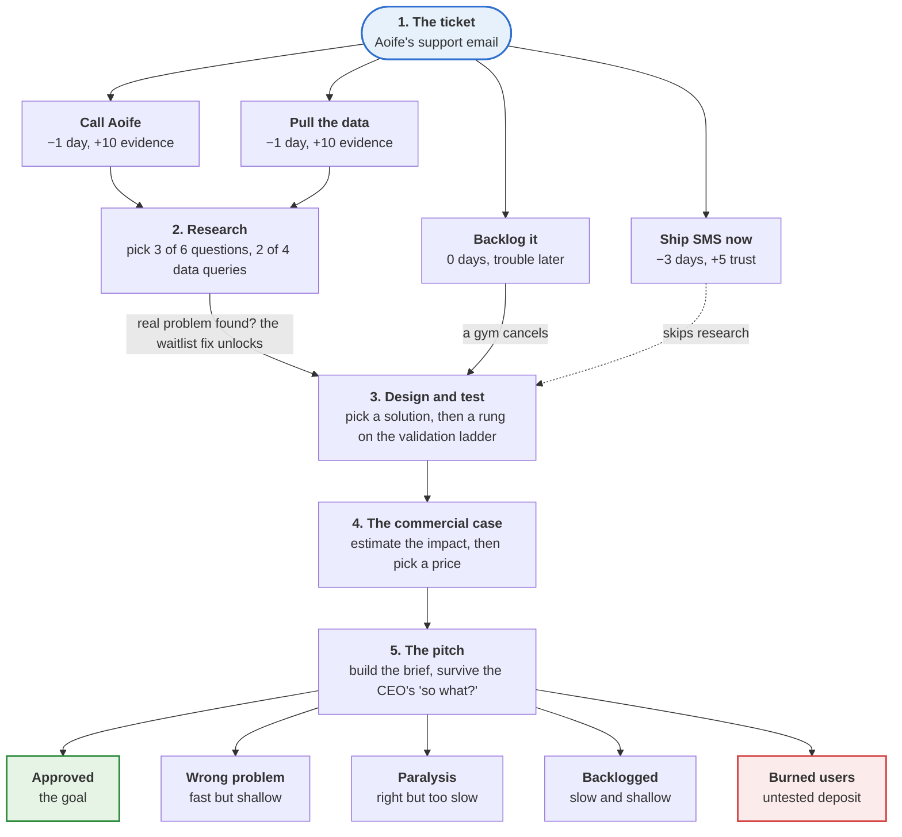
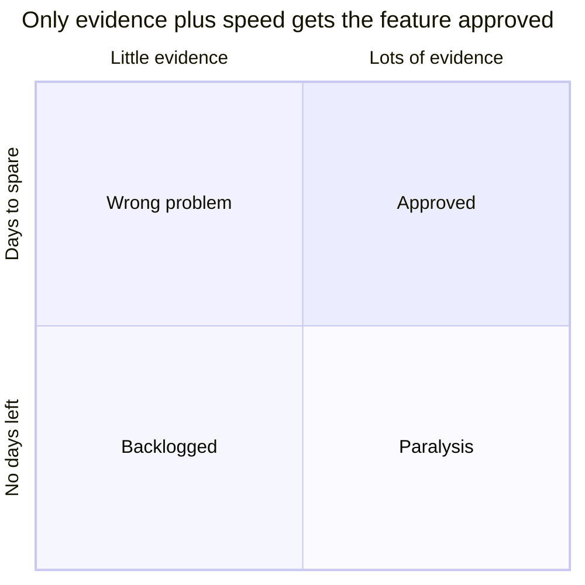

# SlotBook Simulator: Game Design

## Overview

The SlotBook Simulator is a 10–15 minute choose-your-path game that drops the player into week one as a founding engineer. One support ticket arrives. The player decides how to investigate it, what to build, how to test it and how to pitch it. Every choice moves live meters, and the game shows the consequences immediately.

| | |
| --- | --- |
| **Player role** | Founding engineer #3 at SlotBook, a class-booking app for Irish gyms (fictional) |
| **Starting position** | 120 gym customers paying €49/month; 20 engineering days before the next founders' planning meeting |
| **Goal** | Walk into that meeting with a feature the founders approve, backed by evidence and a commercial case |
| **Tone** | A serious simulator, like a flight sim for product decisions: realistic numbers, honest consequences, a little dry humour in the feedback |
| **Length** | 5 stages, 12–15 decisions, about 10–15 minutes |
| **Replayability** | A hidden "real problem" is only uncovered by good research, so players who rush get a different game from players who investigate |

**Design principle:** there are no instant "wrong answer" screens. Like a real startup, bad choices still let you play on; they just cost days, trust or money, and the consequences surface later. The debrief explains *why*, linking back to the Commercialisation for Founding Engineers page.

**The hidden truth.** The gym owner says the problem is "chasing no-shows". The real commercial problem is that no-shows hold spots in **fully booked classes with waitlists**, so paying members get turned away and gyms blame SlotBook. Players only discover this through good questions or the right data query.

---

## The dashboard

Four meters sit at the top of the screen and animate after every choice. They are the game's way of teaching that every engineering decision has a commercial cost.

| Meter | Starts at | What moves it | Game over if... |
| --- | --- | --- | --- |
| **Days left** | 20 | Every action costs engineering days (calls 1, data queries 1, builds 3–8) | It hits 0 before the pitch: the founders decide without you |
| **Evidence** | 0 / 100 | Good questions, the right data, real test results | (no fail state; it scores your pitch) |
| **Founder trust** | 50 / 100 | Shipping on time, clear updates, pitches that lead with the customer | It drops below 20: you're taken off the project |
| **MRR** | €5,880 | Gyms churning (−€49 each), add-on revenue in the simulated rollout | (no fail state; it's the scoreboard) |

A fifth, **hidden** variable, `truthFound` (true/false), records whether the player uncovered the waitlist problem. It changes which solutions work and which endings are reachable.

**Screen layout (wireframe):**

```text
┌──────────────────────────────────────────────────────────────────────────┐
│ ┌─────────────┐ ┌─────────────┐ ┌───────────────┐ ┌─────────────┐        │
│ │ Days left   │ │ Evidence    │ │ Founder trust │ │ MRR         │        │
│ │ 14  ███░░   │ │ 35/100 ██░░ │ │ 55/100 ███░░  │ │ €5,880 ███░ │        │
│ └─────────────┘ └─────────────┘ └───────────────┘ └─────────────┘        │
│ ┌───────────────────────────────────────────┐ ┌────────────────────────┐ │
│ │ STAGE 2 · RESEARCH                        │ │ Evidence notebook      │ │
│ │ The interview with Aoife                  │ │ ┌────────────────────┐ │ │
│ │ ( "Eight people on the waitlist,          │ │ │18% no-shows, peak  │ │ │
│ │    four empty bikes." )                   │ │ └────────────────────┘ │ │
│ │ Pick your next question (2 left):         │ │ ┌────────────────────┐ │ │
│ │ [ What happens to the people on the       │ │ │45 min a day on     │ │ │
│ │   waitlist?                             ] │ │ │no-shows            │ │ │
│ │ [ Would you use an automatic reminder     │ │ └────────────────────┘ │ │
│ │   feature?                              ] │ │ ┌ ─ ─ ─ ─ ─ ─ ─ ─ ─ ─┐ │ │
│ │ + 2 more questions                        │ │  "I'd definitely pay"  │ │
│ │                                           │ │ └ ─ ─ ─ (weak) ─ ─ ─ ┘ │ │
│ └───────────────────────────────────────────┘ └────────────────────────┘ │
│ ┌──────────────────────────────────────────────────────────────────────┐ │
│ │ +15 evidence, −1 day                                                 │ │
│ │ You found the real problem: no-shows are locking waitlisted members  │ │
│ │ out of full classes.                                                 │ │
│ └──────────────────────────────────────────────────────────────────────┘ │
└──────────────────────────────────────────────────────────────────────────┘
```

> **Final edit:** meters along the top with progress bars, the scene card in the middle, the evidence notebook on the right (weak cards get a dashed border), and a green or red consequence toast along the bottom.

The **evidence notebook** on the right fills with cards the player earns ("18% no-show rate on peak classes"). In Stage 5, they pick cards from it to build their pitch, so research has a visible payoff.

---

## Story map



The game is a funnel, not a sprawling tree: every route reaches the pitch, which keeps the content manageable to write. What differs is the evidence you carry in and the solutions open to you.

---

## Stage-by-stage scenes

All numbers below are **game data**: invented for the simulation, tuned so good commercial habits win. Effects are written as changes to Days / Evidence / Trust / MRR.

### Stage 1: The ticket (Day 1)

> **Support inbox:** "My front desk spends ages every morning chasing people who booked a class and didn't show. Can you fix this?" — Aoife, owner, PowerHouse Gym Galway

| Choice | Days | Evid. | Trust | Other effect | Feedback shown |
| --- | --- | --- | --- | --- | --- |
| Ship SMS reminders tonight | −3 | 0 | +5 | Skips Stage 2; locks in reminders | "Fast. But you've fixed a problem you haven't confirmed. What did 'fix this' actually mean?" |
| Book a 20-minute call with Aoife | −1 | +10 | 0 | Unlocks the interview | "One conversation before one line of code. Good instinct." |
| Pull the booking data first | −1 | +10 | 0 | Card: *18% no-shows on peak classes* | "Data shows you what is happening. It won't tell you why." |
| Add it to the backlog | 0 | 0 | 0 | Stage 3 event: two more gyms complain, one cancels (MRR −€49) | "Ignored signals compound. Two more tickets this week." |

### Stage 2: Research (Days 2–5)

**2a. The interview.** The player picks 3 of 6 questions. Each answer appears as a chat bubble from Aoife.

| Question | Type | Effect | Aoife's answer / feedback |
| --- | --- | --- | --- |
| "Tell me about the last time a full class had no-shows." | Mom Test | +10 | "Tuesday 6am. Eight people on the waitlist, four empty bikes." |
| "What do you do about it today?" | Mom Test | +10 | Card: *Front desk spends 45 min/day ringing no-shows* |
| "What happens to the people on the waitlist?" | Mom Test | +15, `truthFound = true` | "They're furious. Two quit last month because they can never get in." |
| "Would you use an automatic reminder feature?" | Hypothetical | 0, adds weak card | "Yes, definitely!" Feedback: "Of course she said yes. Hypotheticals flatter you." |
| "How much would you pay for this?" | Hypothetical | 0, adds weak card | "€50 a month, easy." (Stage 4 adoption will prove this wrong.) |
| "Don't you think our app should handle this?" | Leading | 0, Trust −2 | Feedback: "You just told her the answer. You learned nothing." |

**2b. The data.** The player picks 2 of 4 queries (1 day each), or skips research entirely.

| Query | Effect | Card earned |
| --- | --- | --- |
| No-show rate by class time | +10 | *Peak classes (6–7am, 6–7pm): 18% no-shows* |
| Waitlists on full classes | +15, `truthFound = true` | *70% of peak classes have a waitlist* |
| Cancellation reasons, last 6 months | +15 | *3 of the last 5 gyms that left cited "members can't get into classes"* |
| Competitor pricing pages | +5 | *Two competitors bundle waitlist tools in a premium tier* |

### Stage 3: Design and test (Days 6–15)

**3a. Pick a solution.**

| Solution | Build days | Simulated result | Catch |
| --- | --- | --- | --- |
| SMS reminders | 4 | No-shows 18% → 14% | Each SMS costs money: who pays? |
| Refundable booking deposit | 8 | No-shows 18% → 6% | Members hate it unless tested gently first |
| Auto-release + waitlist promotion *(only if `truthFound`)* | 6 | Peak-class fill 82% → 97% | None; it solves the real problem |
| Auto-release + reminders | 9 | Best of both | Expensive in days |

**3b. Pick how to test it** (the validation ladder).

| Test | Days | Evidence | Result |
| --- | --- | --- | --- |
| Fake door: "Smart waitlist, coming soon" button | 1 | +10 | *41 of 120 gyms clicked in 3 days* |
| Wizard of Oz: you text waitlisted members by hand for one gym | 3 | +20 | *Pilot gym filled 23 extra spots in a week* |
| Feature flag to 10 gyms | build + 2 | +25 | A before/after chart of the real metric |
| Launch to all 120 gyms | build only | +15 | Deposit option: 2 gyms churn (MRR −€98, Trust −15) |

### Stage 4: The commercial case (Day 16)

The player first **types their own estimate** of annual impact, then picks a pricing model and the sim reveals the outcome. An estimate within 25% of the simulation earns +5 Evidence.

| Pricing model | Simulated adoption | Simulated impact per year |
| --- | --- | --- |
| Free for all (retention play) | All 120 gyms | ~1 cancellation prevented per month: 12 gyms × €588 = €7,056 kept |
| €10/month add-on | 30 gyms | 30 × €10 × 12 = €3,600 new |
| €25/month add-on | 10 gyms | 10 × €25 × 12 = €3,000 new, fewer gyms helped |
| Raise every plan by €5 | 117 gyms (3 leave) | 117 × €54 × 12 vs 120 × €49 × 12 = +€5,256 net |

Feedback reveals there's no single right answer: the strongest pitches pick a model *and* explain the trade-off.

### Stage 5: The pitch (Day 20)

**5a. Build the brief.** The player chooses an opening line, three evidence cards from their notebook and an ask.

| Opening line | Trust |
| --- | --- |
| "I built a waitlist service with webhooks and a job queue." | −10 (code-first) |
| "Gyms are losing members because full classes have empty spots." | +10 (customer-first) |
| "I've got a feature I think is really cool." | −5 |

Weak cards ("Aoife said she'd definitely pay") are flagged by the CEO in the next step.

**5b. The CEO's "so what?" round.** Three challenges, each with 2–3 replies.

| CEO asks | Strong reply | Weak reply |
| --- | --- | --- |
| "Every app has reminders. So what?" | "This fills spots for waitlisted members; that's why gyms are leaving." | "Ours are better designed." |
| "How do you know they'll pay?" | "41 gyms clicked the fake door and the pilot filled 23 spots." | "Aoife told me she would." |
| "What are you *not* building if we do this?" | "The reporting dashboard slips two weeks." | "Nothing, I'll do it at weekends." (Trust −5: "Founders want honest trade-offs, not heroics.") |

---

## Endings and the scorecard

The ending depends on two things the player controls: how much **evidence** they gathered and how many **days** they had left when it mattered. That trade-off between learning and speed is the core lesson.



| Ending | Evidence | Days left | What happened |
| --- | --- | --- | --- |
| **Approved** | High | Some | Found the waitlist problem, tested cheaply, pitched with evidence. Feature approved. |
| **Wrong problem** | Low | Some | Shipped reminders fast; no-shows barely moved. Founders: "Why did we build this?" |
| **Paralysis** | High | None | Great research, but the days ran out. The meeting happened without your pitch. |
| **Backlogged** | Low | None | Ignored the ticket; gyms kept cancelling. The founders decided without you. |

> **Final edit:** a 2×2 grid with "Approved" shaded green, and a red callout under it for the special ending.

**Special ending, "Burned users":** launching the deposit to all 120 gyms without a test triggers an angry-member event, two gyms cancel and the founders pause the feature. It teaches that the riskiest ideas need the cheapest tests.

Every ending closes on a **scorecard**, graded A–D:

| Skill | Measured by | Example feedback |
| --- | --- | --- |
| Customer insight | Final Evidence score; whether `truthFound` | "You found the waitlist problem. Most players never ask." |
| Speed | Days left at the pitch | "8 days to spare. You tested cheaply before you built." |
| Commercial thinking | Stage 4 estimate accuracy and pricing rationale | "Your estimate was within 10% of the simulation." |
| Founder communication | Final Founder trust | "You led with code. The CEO stopped listening at 'webhooks'." |

Below the grades, a **"Concepts you used"** strip links each skill back to the Commercialisation for Founding Engineers page: the Mom Test, the validation ladder, building for the customers you can win, crossing the chasm. Then two buttons: **Replay** and **Try the other path**.

---

## Build notes for the web team

Keep the story in **data, not code**: every scene is a JSON object, so writers can tune numbers and text without touching components.

**Game state:**

```ts
type GameState = {
  stage: 1 | 2 | 3 | 4 | 5;
  sceneId: string;
  daysLeft: number;      // starts 20
  evidence: number;      // 0-100
  trust: number;         // 0-100, starts 50
  mrr: number;           // starts 5880
  truthFound: boolean;   // hidden
  flags: string[];       // e.g. "falseConfidence", "skippedResearch"
  cards: EvidenceCard[]; // the notebook
  history: string[];     // choice ids, for the debrief
};
```

**One scene:**

```json
{
  "id": "s1-ticket",
  "stage": 1,
  "title": "The ticket",
  "body": "My front desk spends ages every morning chasing no-shows...",
  "choices": [
    {
      "id": "call-owner",
      "label": "Book a 20-minute call with Aoife",
      "effects": { "daysLeft": -1, "evidence": 10 },
      "feedback": "One conversation before one line of code.",
      "next": "s2-interview"
    },
    {
      "id": "ship-sms",
      "label": "Ship SMS reminders tonight",
      "effects": { "daysLeft": -3, "trust": 5 },
      "setFlags": ["skippedResearch"],
      "feedback": "Fast. But you've fixed a problem you haven't confirmed.",
      "next": "s3-design"
    }
  ]
}
```

Optional fields: `requires` (e.g. `{"truthFound": true}` to show a choice), `addCards`, `pickCount` (for "choose 3 of 6").

**Components:**

| Component | Job |
| --- | --- |
| `MeterBar` | Four animated meters; flash red or green on change |
| `SceneCard` | Title, body, chat bubbles for interview answers |
| `ChoiceList` | Buttons, or multi-select when `pickCount` is set |
| `ConsequenceToast` | Feedback line plus the meter deltas, e.g. "−1 day, +10 evidence" |
| `Notebook` | Evidence cards; weak cards get a dashed border |
| `ResultsChart` | Before/after bars for Stage 3 test results |
| `EstimateInput` | Stage 4 number input, compared with the simulated value |
| `Scorecard` | Grades, the ending, concept links, Replay |

**Accessibility:** meters need text values, not colour alone; every choice must be keyboard-reachable; toasts should be announced to screen readers (`aria-live="polite"`).
